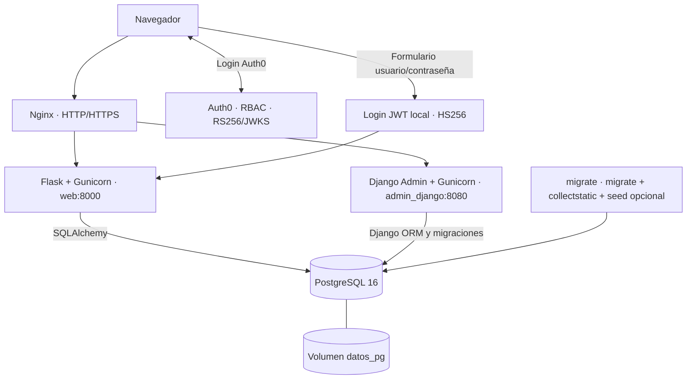

# La Carta 2.0 — Examen práctico ISW-233

Sistema web de gestión de restaurantes, carta gastronómica, pedidos y cocina. Integra **dos mecanismos de autenticación dentro de la misma aplicación Flask**: **Auth0** y **cuentas locales con JWT**. Incluye **Django Admin** para administrar datos y perfiles, **PostgreSQL 16** como base compartida, y despliegue en **AWS EC2 Ubuntu** con Docker Compose, Gunicorn, Nginx y HTTPS.

> **Entorno de demostración académica.** El comando de poblado permite crear un conjunto objetivo de 10.000 filas. Las cuentas de demostración con roles privilegiados y sus contraseñas solo deben habilitarse en un entorno controlado.

## 1. Direcciones de acceso

| Servicio | Dirección |
|---|---|
| Catálogo público | https://cartadragonpai.chickenkiller.com/restaurantes |
| Inicio de sesión unificado | https://cartadragonpai.chickenkiller.com/auth/local/entrar |
| Cocina JWT local | https://cartadragonpai.chickenkiller.com/cocina-local |
| Administración JWT local | https://cartadragonpai.chickenkiller.com/administrar/local |
| Django Admin | https://admindragonpai.chickenkiller.com/admin/ |

Las rutas `/cocina` y `/administrar/` sirven HTML cuando la petición está autenticada por Auth0 y JSON para un JWT local validado; por ello, las páginas `/cocina-local` y `/administrar/local` hacen las peticiones protegidas desde JavaScript. El dominio principal y el subdominio de Django se administran mediante FreeDNS. En desarrollo local se utiliza `http://localhost`.

## 2. Arquitectura



Servicios Compose: `db`, `migrate`, `web`, `admin_django` y `nginx`.

- Django define y migra el esquema mediante `carta/models.py` y `carta/migrations/`; Flask consulta las mismas tablas mediante `app/models.py` y SQLAlchemy. **No usar `db.create_all()` ni Flask-Migrate para modificar este esquema.**
- Nginx publica los puertos 80 y 443, con redirección a HTTPS en producción; PostgreSQL solo es accesible por la red interna de Docker.
- `migrate` espera a PostgreSQL saludable, aplica migraciones, recopila estáticos, prepara el superusuario Django y ejecuta el poblado si se habilita. `web` y `admin_django` esperan a que finalice correctamente.
- Los volúmenes `datos_pg` y `static_files` persisten entre recreaciones normales de contenedores. **No ejecutar `docker compose down -v` en una base con datos.**

## 3. Autenticación y roles

La misma interfaz de La Carta 2.0 admite dos entradas:

**Auth0:** inicio de sesión mediante OAuth2/OIDC; tokens de acceso RS256 verificados con JWKS. La identidad autenticada se conserva en la sesión Flask y las páginas originales siguen funcionando.

**JWT local:** registro e inicio de sesión con `username` y contraseña. La contraseña se conserva como **hash Werkzeug**, nunca en texto plano. Flask firma JWT HS256 con `LOCAL_JWT_SECRET_KEY`, expiración e issuer configurables. El navegador conserva el JWT en `sessionStorage` y JavaScript lo envía mediante `Authorization: Bearer <token>`; las navegaciones normales no añaden ese encabezado automáticamente.

| Rol | Permisos |
|---|---|
| Cliente (`cliente`) | `create:pedidos`, `read:mis-pedidos` |
| Cocina (`cocina`) | `read:pedidos`, `update:pedidos` |
| Administrador (`admin`) | `read:pedidos`, `write:carta`, `delete:carta` |

Para las cuentas locales, los permisos se obtienen del **rol almacenado en PostgreSQL**, no de un rol enviado por el navegador. El registro público crea exclusivamente cuentas `cliente`; los cambios a `cocina` o `admin` se efectúan desde Django Admin por un superusuario autorizado. Los decoradores `@requires_auth` verifican identidad y permiso en las rutas protegidas. Un cliente autenticado que envía JWT para acceder a cocina o administración recibe `403`.

### Relación de perfiles

- `Usuario`: datos personales e identificador interno o `auth0_sub`.
- `CuentaLocal`: `username`, `password_hash`, `rol` y vínculo opcional uno a uno con `Usuario`.
- `Cliente`: perfil de cliente relacionado uno a uno con `Usuario`.
- `Empleado`: perfil vinculado a `Usuario`, con restaurante asignado y estado activo.

Para operar en cocina con JWT, no basta poseer el rol: el servidor comprueba también la relación `CuentaLocal → Usuario → Empleado`, su activación y el restaurante. La consulta y avance de pedidos están restringidos al restaurante asignado. Para Auth0 se conserva la identificación mediante `Usuario.auth0_sub`. **Django Admin tiene su propia autenticación**, diferente del login de Flask.

## 4. Funcionalidades y reglas de negocio

### Clientes

- Consulta de restaurantes y platos públicos.
- Creación de pedidos solo con platos existentes, disponibles y pertenecientes al restaurante seleccionado.
- Validación de cantidades y cálculo del total en el servidor; el precio nunca se acepta del navegador como fuente de verdad.
- Conservación del precio unitario histórico en `ItemPedido`.
- Consulta de pedidos propios y de sus ítems; cancelación únicamente cuando el pedido está `pendiente`.
- Los intentos de acceder a pedidos ajenos devuelven `404` para no revelar su existencia.

### Cocina

- Cola de pedidos activos del restaurante asignado.
- Transiciones permitidas: `pendiente → en_preparacion → listo → entregado`.
- Actualización condicional de estado para evitar sobrescribir cambios concurrentes; las operaciones de restaurantes ajenos no están autorizadas.

### Administración de la carta

- Crear, consultar, editar y eliminar restaurantes y platos.
- Validaciones de nombre, precio, existencia de restaurante y disponibilidad.
- Protección de eliminación cuando existen relaciones históricas que impiden borrar registros.
- El administrador Auth0 conserva formularios HTML y redirecciones; el administrador JWT utiliza el panel JavaScript con respuestas JSON.

Los controles relevantes se aplican en Flask y PostgreSQL, no únicamente mediante ocultamiento de botones.

## 5. Estructura principal

```text
app/
  auth/                        # Auth0 y JWT local
  templates/
    base.html                  # Menú según autenticación y permisos
    carta/                     # Catálogo, pedidos y cocina
    carta_admin/               # Administración HTML y panel JWT
    auth/                      # Inicio de sesión unificado
  static/js/                   # Fetch con JWT para vistas locales
  carta_routes.py             # Pedidos y cocina
  carta_admin_routes.py       # CRUD de la carta
  models.py                    # Modelos SQLAlchemy
carta/
  models.py                    # Modelos Django
  admin.py                     # Administración de modelos y roles
  migrations/                  # Migraciones Django, incluidas 0004–0006
  management/commands/seed_demo.py
config/                        # Configuración Django
docker-compose.yml             # Entorno base/local
docker-compose.prod.yml        # Ajustes de producción
nginx/dev.conf
nginx/prod.conf
```

## 6. Desarrollo local (Windows + Docker Desktop)

Requisitos: Git, Docker Desktop y Docker Compose. Clonar la **rama que contenga los cambios JWT** (en el despliegue actual se utilizó `recuperatorio`, si continúa siendo la rama de trabajo):

```powershell
git clone -b recuperatorio --single-branch https://github.com/Andress-Mallea/Todo-App-P1.git
cd Todo-App-P1
Copy-Item .env.example .env
# Completar .env con los secretos y parámetros propios.
docker compose -f docker-compose.yml config --quiet
docker compose -f docker-compose.yml up -d --build
docker compose -f docker-compose.yml ps -a
```

Si `.env.example` no está disponible, crear manualmente un `.env` privado con las variables indicadas abajo. Si trabajas con otra rama, cambia `recuperatorio` por su nombre real.

### Variables de entorno

| Variable | Propósito |
|---|---|
| `POSTGRES_USER`, `POSTGRES_PASSWORD`, `POSTGRES_DB` | Conexión PostgreSQL |
| `DJANGO_SECRET_KEY`, `DJANGO_DEBUG`, `DJANGO_ALLOWED_HOSTS` | Django |
| `DJANGO_SUPERUSER_USERNAME`, `DJANGO_SUPERUSER_EMAIL`, `DJANGO_SUPERUSER_PASSWORD` | Cuenta administrativa Django |
| `SECRET_KEY` | Sesiones Flask |
| `AUTH0_DOMAIN`, `AUTH0_AUDIENCE`, `AUTH0_CLIENT_ID`, `AUTH0_CLIENT_SECRET` | Autenticación Auth0 |
| `LOCAL_JWT_SECRET_KEY`, `LOCAL_JWT_EXPIRES_MINUTES`, `LOCAL_JWT_ISSUER` | JWT local |
| `SEED_DEMO_ENABLED` | `1` para poblar, `0` para omitir |
| `SEED_CLIENTE_PASSWORD`, `SEED_COCINA_PASSWORD`, `SEED_ADMIN_PASSWORD` | Credenciales iniciales privadas de las tres cuentas demo principales |

El archivo `.env` **nunca se sube al repositorio**. Utilizar contraseñas diferentes, fuertes y no conocidas públicamente. Al iniciar PostgreSQL por primera vez, cambiar posteriormente las variables `POSTGRES_*` no cambia por sí solo las credenciales de una base ya inicializada.

## 7. Poblado automático: 10.000 registros

El comando Django `python manage.py seed_demo` se ejecuta automáticamente en el servicio `migrate` después de las migraciones si `SEED_DEMO_ENABLED=1`.

| Tabla | Objetivo de filas de demostración |
|---|---:|
| Usuario | 1.501 |
| CuentaLocal | 1.501 |
| Cliente | 1.200 |
| Empleado | 300 |
| Restaurante | 20 |
| Plato | 1.398 |
| Categoria | 30 |
| Mesa | 500 |
| Promocion | 500 |
| PromocionPlato | 1.000 |
| Pedido | 900 |
| ItemPedido | 1.150 |
| **Total previsto por el seed** | **10.000** |

El seed usa identificadores estables y `get_or_create()` para volver a ejecutarse sin duplicar sus filas. Preserva datos previos, incluidos los del poblado anterior. El **total real de la base puede superar 10.000** si existen registros creados por usuarios o pruebas. No debe interpretarse como un límite estricto sobre todas las filas de producción.

Se crean cuentas de demostración de cliente, cocina y administrador con perfiles relacionados. Las tres contraseñas principales se configuran en el `.env`; las cuentas generadas restantes usan credenciales no publicadas. No habilitar este seed en producción abierta a usuarios reales.

Verificar el arranque:

```bash
docker compose -f docker-compose.yml -f docker-compose.prod.yml logs --tail=100 migrate
docker compose -f docker-compose.yml -f docker-compose.prod.yml ps -a
```

`migrate` debe terminar con código `0`. El seed no requiere ejecutar manualmente un comando dentro de EC2 cuando está habilitado en Compose.

## 8. Despliegue en una nueva AWS EC2 Ubuntu

### 8.1 Preparación de la instancia

1. Crear la instancia Ubuntu y configurar el Security Group: puertos TCP **80 y 443** públicos; **22** solo desde la IP administrativa.
2. Instalar Git, Docker Engine y Docker Compose. Puede automatizarse con `scripts/preparar_ec2.sh` mediante **EC2 User Data** durante la creación de la instancia; el script debe pegarse como contenido Bash, sin contraseñas. Alternativamente, ejecutarlo manualmente con `sudo bash scripts/preparar_ec2.sh` si existe en el repositorio.
3. Confirmar instalación:

```bash
sudo cloud-init status --wait
docker --version
docker compose version
git --version
```

Si aparece `permission denied` al conectar con `/var/run/docker.sock`, usar `sudo docker compose` o añadir el usuario administrativo al grupo `docker` y renovar la sesión. **El grupo `docker` concede privilegios elevados.**

### 8.2 Descargar el proyecto y preparar el entorno

```bash
mkdir -p ~/proyectos
cd ~/proyectos
git clone -b recuperatorio --single-branch https://github.com/Andress-Mallea/Todo-App-P1.git .
# Colocar .env mediante un canal seguro y ajustar permisos:
chmod 600 .env
# Validar los archivos de Compose:
docker compose -f docker-compose.yml -f docker-compose.prod.yml config --quiet
```

> Si ya existe el repositorio en `~/proyectos`, **no lo clones de nuevo**: revisa la rama con `git branch --show-current` y actualiza mediante el flujo normal de Git. No publiques el `.env` ni contraseñas en logs o commits.

Para EC2, `docker-compose.prod.yml` activa `SESSION_COOKIE_SECURE=1`, `DJANGO_DEBUG=False`, hosts y orígenes CSRF de Django, los certificados de Let's Encrypt y `nginx/prod.conf`.

### 8.3 FreeDNS y certificados HTTPS

Actualizar los registros `A` de ambos dominios para la IP pública de la instancia:

```bash
getent ahostsv4 cartadragonpai.chickenkiller.com
getent ahostsv4 admindragonpai.chickenkiller.com
```

Con el puerto 80 disponible y los dominios resueltos correctamente:

```bash
sudo apt update
sudo apt install -y certbot
sudo certbot certonly --standalone \
  -d cartadragonpai.chickenkiller.com \
  -d admindragonpai.chickenkiller.com \
  --cert-name cartadragonpai.chickenkiller.com
```

Nginx espera `/etc/letsencrypt/live/cartadragonpai.chickenkiller.com/fullchain.pem` y `privkey.pem`. **Emitir los certificados antes de arrancar el Compose de producción**; Nginx no puede iniciar con archivos de certificado inexistentes. Comprobar la renovación automatizada de Certbot y planificar la recarga de Nginx tras renovar.

### 8.4 Iniciar la aplicación

En una base nueva de demostración, con `.env` correctamente configurado y `SEED_DEMO_ENABLED=1`:

```bash
docker compose -f docker-compose.yml -f docker-compose.prod.yml up -d --build
docker compose -f docker-compose.yml -f docker-compose.prod.yml ps -a
docker compose -f docker-compose.yml -f docker-compose.prod.yml logs --tail=100 migrate
```

En un entorno con datos importantes realizar respaldo PostgreSQL antes de desplegar y considerar `SEED_DEMO_ENABLED=0`. Evitar `down -v` y restauraciones destructivas no planificadas.

### 8.5 Comprobación posterior

```bash
curl -I http://cartadragonpai.chickenkiller.com/restaurantes
curl -I https://cartadragonpai.chickenkiller.com/restaurantes
curl -I https://admindragonpai.chickenkiller.com/admin/
sudo certbot renew --dry-run
```

En Auth0 comprobar las URLs autorizadas de callback, logout y origen web para el dominio HTTPS real. Para una aplicación Flask con callback `/auth/callback`, la URL autorizada correspondiente es `https://cartadragonpai.chickenkiller.com/auth/callback`.

## 9. Pruebas y verificación funcional

Las pruebas existentes están en `tests/`. En desarrollo local:

```powershell
docker compose -f docker-compose.yml exec web python -m pytest -q
```

El README anterior registraba **7 pruebas exitosas en una versión anterior**; ese resultado no se atribuye automáticamente a los cambios nuevos de JWT, roles y poblado. Ejecutar nuevamente las pruebas cuando se prepare la entrega final.

Comprobaciones manuales recomendadas:

- Cliente JWT: crear, listar, consultar y cancelar únicamente sus pedidos pendientes.
- Cocina JWT: consultar y avanzar pedidos solamente del restaurante del empleado activo; otro restaurante debe permanecer fuera de alcance.
- Administrador JWT: crear, editar y eliminar restaurantes y platos desde `/administrar/local`.
- Cambiar roles en Django Admin y comprobar que el menú y los permisos reflejen el nuevo rol sin permitir autoasignación de privilegios.
- Auth0: repetir login y funcionalidades de cliente, cocina y administrador.
- Accesos denegados: JWT cliente a `/cocina` y `/administrar/` con encabezado Bearer devuelve `403`; sin JWT en navegación directa puede mostrarse la pantalla de login.
- Verificar migraciones `0004`, `0005` y `0006`, población demo, vínculos de cuentas y comportamiento HTTPS.

## 10. Seguridad y decisiones técnicas

1. **Una única fuente de esquema:** Django administra las migraciones; SQLAlchemy solo representa las tablas compartidas en Flask.
2. **Autenticación separada de autorización:** Auth0 verifica tokens RS256; JWT local se firma y valida con HS256, y Flask consulta roles de PostgreSQL antes de autorizar.
3. **Mínimo privilegio:** el registro público crea clientes; únicamente Django Admin autorizado puede promover cuentas locales a cocina o administrador.
4. **Aislamiento:** los pedidos se vinculan con la identidad validada y cocina se limita por empleado activo/restaurante.
5. **Integridad:** precios históricos, transacciones, validaciones y restricciones SQL evitan operaciones inconsistentes.
6. **Secretos fuera de Git:** `.env`, contraseñas, llaves y material privado SSL no deben incorporarse al repositorio.
7. **Demo controlada:** no exponer credenciales conocidas o privilegiadas en una instalación destinada al público; desactivar el poblado en entornos que no lo requieran.

## 11. Limitaciones y mantenimiento

- La EC2 de laboratorio es temporal: respaldar con `pg_dump` y conservar copias fuera de la instancia si los datos deben sobrevivir a su eliminación.
- `sessionStorage` no envía JWT en navegaciones normales; las pantallas JWT usan JavaScript para llamar a los endpoints protegidos.
- Los formularios JWT de administración utilizan algunas ventanas `prompt()`/`confirm()`; podrían sustituirse por formularios accesibles integrados.
- El poblado crea datos de demostración, no sustituye un proceso seguro de altas de personal para un sistema comercial real.
- La renovación de Certbot y recarga de Nginx deben comprobarse periódicamente.
- No se implementan pagos ni notificaciones en tiempo real; quedan fuera del alcance actual.

## 12. Guía rápida para la defensa

1. Abrir el catálogo sin autenticación.
2. Mostrar el login unificado: Auth0 o JWT local en la misma aplicación.
3. Demostrar que un cliente JWT solo gestiona pedidos propios.
4. Entrar con cocina JWT y avanzar un pedido de su restaurante.
5. Entrar con administrador JWT y gestionar restaurantes y platos.
6. Cambiar el rol y la vinculación a empleado en Django Admin.
7. Explicar las diferencias entre autenticación (Auth0/JWT) y permisos consultados en servidor.
8. Mostrar las migraciones Django, los contenedores Compose y el reporte del seed de 10.000 filas.
9. Comprobar los dominios HTTPS y explicar la instalación automatizada mediante EC2 User Data.

**Entrega:** no incluir `.env`, contraseñas, tokens, secretos Auth0, archivos `.pem` o llaves SSH en GitHub. Antes de fusionar ramas, comprobar que los archivos documentados se encuentran en la rama definitiva.
