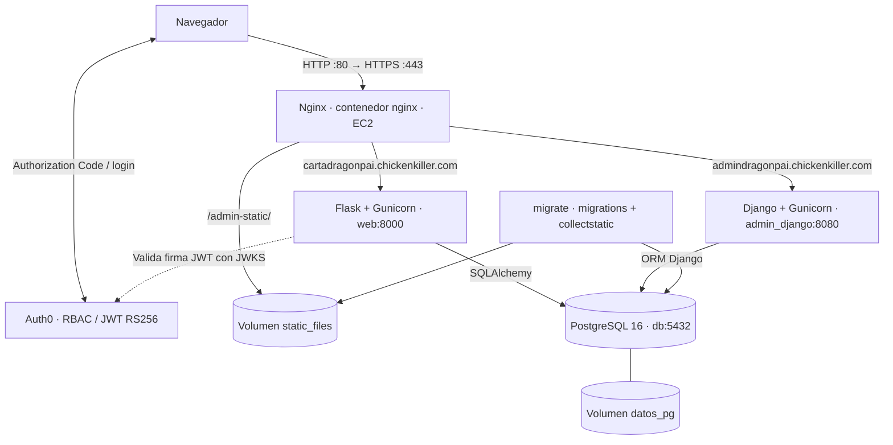

# La Carta 2.0 — Examen práctico ISW-233

Sistema web de restaurantes y pedidos. **Flask** implementa la carta, los pedidos y el panel de cocina; **Django Admin** gestiona datos internos y es el único responsable del esquema de base de datos. Ambos comparten **PostgreSQL 16** y se publican en **AWS EC2 Ubuntu**, mediante **Docker Compose, Gunicorn, Nginx y HTTPS**. Los usuarios de Flask se autentican con **Auth0**.

## 1. URLs públicas

| Servicio | Dirección |
|---|---|
| Carta pública de Flask | https://cartadragonpai.chickenkiller.com/restaurantes |
| Cocina (Auth0, rol `cocina`) | https://cartadragonpai.chickenkiller.com/cocina |
| Pedidos del cliente | https://cartadragonpai.chickenkiller.com/pedidos |
| Django Admin (cuenta de Django) | https://admindragonpai.chickenkiller.com/admin/ |

Los dominios se administran con FreeDNS. La IPv4 de EC2 puede cambiar al reiniciar el laboratorio; en ese caso se actualizan **ambos registros A** y se verifica su resolución antes de emitir certificados. Desarrollo local: `http://localhost/restaurantes` y `http://localhost/admin/`.

## 2. Arquitectura real



- **Puertos públicos:** solo `80` (redirección) y `443` (HTTPS). SSH `22` se limita desde el Security Group de EC2.
- **Puertos internos:** `web:8000`, `admin_django:8080`, `db:5432`. No se publica PostgreSQL hacia Internet.
- `migrate` espera a que `db` esté **healthy**; `web` y `admin_django` esperan a que `migrate` termine con éxito.
- Nginx comparte el volumen de archivos estáticos producido por `collectstatic` y monta los certificados de Let's Encrypt desde el host.

## 3. Modelos y reglas de negocio (R1)

Los modelos `Restaurante`, `Plato`, `Pedido`, `ItemPedido`, `Usuario`, `Cliente`, `Empleado`, `Categoria`, `Mesa`, `Promocion` y `PromocionPlato` están en `carta/models.py`. Las migraciones Django crean las tablas `carta_*`; `app/models.py` las mapea en SQLAlchemy para Flask.

- En `app/carta_routes.py`, `crear_pedido` identifica al cliente por el **`sub` del JWT validado**; nunca por un identificador suministrado por el formulario.
- Acepta identificadores de platos y cantidades, valida su existencia, disponibilidad y pertenencia al restaurante, y calcula el total desde los precios actuales de la base.
- Copia el precio de cada plato a `ItemPedido.precio_unitario` para conservar el **precio histórico**.
- Usa `db.session.flush()`, inserta ítems y confirma con **un solo `commit()`**; ante un error SQL realiza `rollback()`.
- La base tiene `CHECK` para estado válido, cantidad positiva, precios y totales no negativos. Se comprobaron con `pg_constraint` en PostgreSQL local.
- El cliente puede cancelar **solo un pedido pendiente** mediante `cancelar`; la cocina avanza mediante `avanzar` según el mapa `SIGUIENTE`: `pendiente → en_preparacion → listo → entregado`.
- Un cliente solo ve pedidos propios; un intento sobre un pedido ajeno devuelve **404**. Los formularios POST exitosos redirigen con **303** (Post/Redirect/Get).

## 4. Auth0 y autorización (R2)

Auth0 proporciona una **Regular Web Application** con Authorization Code y una API con **Enable RBAC** y **Add Permissions in the Access Token**. Flask usa Authlib, verifica los access tokens firmados con RS256 mediante JWKS y conserva el token en una sesión protegida por cookie.

| Rol | Permisos |
|---|---|
| `cliente` | `create:pedidos`, `read:mis-pedidos` |
| `cocina` | `read:pedidos`, `update:pedidos` |
| `admin` | `read:pedidos`, `write:carta`, `delete:carta` |

Los decoradores `@requires_auth` validan la sesión y el permiso en **cada ruta protegida**, no solamente en la interfaz. El `callback` sincroniza `Usuario` y el perfil `Cliente` o `Empleado` en PostgreSQL, sin guardar contraseñas Auth0. Los empleados nuevos pueden permanecer **inactivos y sin restaurante** hasta que Django Admin los asigne y active. Los usuarios del panel Django se autentican con las cuentas propias de Django.

Validaciones realizadas en local: sin sesión `/pedidos` y `/cocina` devuelven `401`; un cliente en `/cocina` recibe `403`; un pedido ajeno devuelve `404`; el cocinero asignado puede avanzar un pedido de su restaurante.

## 5. Backoffice Django (R3)

`carta/admin.py` registra restaurantes, platos, pedidos, ítems, perfiles y otras entidades comerciales. En `PedidoAdmin` existen filtros por estado/restaurante, búsqueda por cliente, `ItemPedidoInline` y campos históricos de solo lectura (`total`, `fecha` y `precio_unitario`). El superusuario puede corregir el estado desde el administrador.

## 6. Instalación local desde cero (R4)

**Requisitos:** Git, Docker Desktop con el complemento Docker Compose, configuración Auth0 y el archivo privado de variables de entorno.

```powershell
git clone https://github.com/Andress-Mallea/Todo-App-P1.git
cd Todo-App-P1
Copy-Item .env.example .env
# Completar .env con valores propios; no utilizar secretos de ejemplo.
docker compose -f docker-compose.yml config --quiet
docker compose -f docker-compose.yml up -d --build
docker compose -f docker-compose.yml ps -a
```

Variables mínimas de `.env`: `POSTGRES_USER`, `POSTGRES_PASSWORD`, `POSTGRES_DB`, `DJANGO_SECRET_KEY`, `DJANGO_SUPERUSER_USERNAME`, `DJANGO_SUPERUSER_EMAIL`, `DJANGO_SUPERUSER_PASSWORD`, `SECRET_KEY`, `AUTH0_DOMAIN`, `AUTH0_AUDIENCE`, `AUTH0_CLIENT_ID`, `AUTH0_CLIENT_SECRET`. Las opciones Django de hosts/CSRF de producción se sobreescriben en `docker-compose.prod.yml`.

La base se inicializa en `db` y el servicio `migrate` ejecuta las migraciones y `collectstatic` **una sola vez por ejecución**, antes de arrancar las aplicaciones. Para comprobar migraciones:

```powershell
docker compose -f docker-compose.yml exec admin_django python manage.py showmigrations carta
```

No usar `docker compose down -v` sobre una base con datos: elimina los volúmenes.

## 7. Producción desde cero en una nueva EC2 (R4/R5)

1. Crear EC2 Ubuntu con Security Group que permita TCP 80 y 443 desde Internet y 22 únicamente desde la IP del administrador. Registrar o actualizar los dominios FreeDNS para apuntar a la IPv4 pública actual.
2. Conectarse mediante SSH/PuTTY e instalar dependencias:

```bash
sudo apt update
sudo apt install -y git curl ca-certificates docker.io docker-compose-v2 certbot dnsutils
sudo systemctl enable --now docker
sudo usermod -aG docker ubuntu
newgrp docker
```

3. Clonar el repositorio y subir el `.env.production` **solo mediante SFTP/WinSCP**, sin almacenarlo en Git:

```bash
mkdir -p ~/proyectos && cd ~/proyectos
git clone https://github.com/Andress-Mallea/Todo-App-P1.git
cd Todo-App-P1
cp .env.production .env
sed -i 's/\r//g' .env
chmod 600 .env
unset POSTGRES_USER POSTGRES_PASSWORD POSTGRES_DB COMPOSE_FILE
```

4. Verificar DNS y arrancar **primero HTTP**:

```bash
dig +short cartadragonpai.chickenkiller.com
dig +short admindragonpai.chickenkiller.com
docker compose -f docker-compose.yml config --quiet
docker compose -f docker-compose.yml up -d --build
docker compose -f docker-compose.yml ps -a
```

5. Detener Nginx temporalmente y emitir certificado para **ambos** nombres:

```bash
docker compose -f docker-compose.yml stop nginx
sudo certbot certonly --standalone \
  -d cartadragonpai.chickenkiller.com \
  -d admindragonpai.chickenkiller.com \
  --cert-name cartadragonpai.chickenkiller.com
sudo ls -l /etc/letsencrypt/live/cartadragonpai.chickenkiller.com/
```

6. Activar producción; `nginx/prod.conf` sirve los dos dominios y redirige HTTP a HTTPS:

```bash
docker compose -f docker-compose.yml -f docker-compose.prod.yml config --quiet
docker compose -f docker-compose.yml -f docker-compose.prod.yml up -d --build --force-recreate
docker compose -f docker-compose.yml -f docker-compose.prod.yml ps -a
```

7. Registrar en Auth0 los **Allowed Callback URLs**, **Allowed Logout URLs** y **Allowed Web Origins** HTTPS reales; la ruta de callback Flask es `/auth/callback`.
8. Verificar:

```bash
curl -I http://cartadragonpai.chickenkiller.com/restaurantes
curl -I http://admindragonpai.chickenkiller.com/admin/
curl -I https://cartadragonpai.chickenkiller.com/restaurantes
curl -I https://admindragonpai.chickenkiller.com/admin/
sudo systemctl is-enabled certbot.timer
sudo systemctl is-active certbot.timer
sudo certbot renew --dry-run
```

En EC2 se verificó: HTTP devuelve `301` a HTTPS, Flask HTTPS `200`, Django Admin HTTPS `302` hacia su login, y **`certbot renew --dry-run` finalizó correctamente** para ambos dominios. Django tiene `SECURE_PROXY_SSL_HEADER` y `CSRF_TRUSTED_ORIGINS` configurados para el proxy.

## 8. Pruebas automáticas (R6)

Pruebas en `tests/test_carta_r6.py` con fixtures de `tests/conftest.py`. La configuración de pruebas utiliza **SQLite en memoria** y sustituye la verificación externa de Auth0 por identidades controladas, por lo que no crea tablas en la base PostgreSQL real.

```powershell
# Local, con Docker en ejecución:
docker compose -f docker-compose.yml exec web python -m pytest -q
```

**Resultado local verificado:** `7 passed in 0.56s` (7/7). Las pruebas cubren: rechazo de pedido sin sesión, cliente sin permiso de cocina, precio adulterado ignorado, rechazo de plato no disponible, pedido ajeno `404`, rechazo de retroceso de estado y aislamiento por restaurante para cocina.

**Limitación documentada:** al repetir pytest dentro del contenedor `web` en EC2, la sesión recolectó los siete casos pero quedó detenida al iniciar `test_01_sin_sesion_no_se_crea_pedido`; la ejecución final en EC2 **no fue validada**. Para la defensa, ejecutar `pytest -q` en la máquina local, tal como contempla la rúbrica.

## 9. Población de datos para demostración

El comando Django `seed_demo` permite crear datos comerciales sin intervenir `Usuario`, `Cliente` ni `Empleado`, cuyos perfiles provienen de Auth0. Se preparó una versión con objetivo de **1.000 registros comerciales** para el requerimiento adicional del docente. **Confirmar los conteos después de ejecutar el comando y antes de afirmar que se alcanzaron los 1.000**. Si la base ya tiene registros reales, el total general puede ser mayor.

```bash
docker compose -f docker-compose.yml -f docker-compose.prod.yml exec admin_django python manage.py seed_demo
```

## 10. Cuatro decisiones justificadas exigidas por la rúbrica

**1. Django controla exclusivamente el esquema.** Los modelos y las migraciones están en `carta/`; Flask usa SQLAlchemy con nombres `__tablename__` compatibles (`carta_pedido`, `carta_itempedido`, etc.). Solo Django migra en producción, evitando dos sistemas que compitan por modificar tablas.

**2. Un pedido ajeno devuelve 404 en vez de 403.** La consulta en `pedido_del_cliente`, de `app/carta_routes.py`, filtra por ID y por `sub` del JWT. Así un tercero no puede confirmar si existe un pedido privado cuyo identificador conoce.

**3. Las reglas se aplican en el servidor.** `crear_pedido` valida los ítems, calcula total/precio congelado y utiliza transacción; `cancelar` admite exclusivamente el estado pendiente; `avanzar` aplica el mapa `SIGUIENTE` y limita la operación al restaurante del empleado. PostgreSQL refuerza las reglas con `CHECK`.

**4. Los secretos no están en Git.** Credenciales PostgreSQL/Auth0 y claves Flask/Django están en el `.env` privado de cada entorno, que se transmite por SFTP y se restringe con `chmod 600` en EC2. Solo usuarios con permisos de administración del servidor y el runtime Docker requieren acceso a estas variables.

## 11. Limitaciones y posibles mejoras

- El laboratorio AWS es **efímero**; para conservar datos entre instancias se necesita respaldo externo (por ejemplo `pg_dump`) y restauración controlada.
- La población de 1.000 registros y su desglose final deben comprobarse contra PostgreSQL de la instancia definitiva.
- El resultado de pytest está confirmado en **local**; la ejecución dentro de EC2 quedó bloqueada durante la primera prueba, sin que se reportara un fallo de aserción.
- La aplicación no implementa pagos, inventario por plato, notificaciones en tiempo real ni correos, funcionalidades fuera del alcance obligatorio del enunciado.
- Para producción permanente, conviene añadir supervisión, respaldo y automatización del despliegue. El certificado y su renovación simulada fueron comprobados en el laboratorio actual.

## 12. Comprobaciones para la defensa

- Navegador sin sesión: carta pública y detalle de restaurante.
- Auth0 cliente: pedido de varios platos, precio histórico, cancelación de pendiente, lista de pedidos propios.
- Auth0 cocina: ver y avanzar solo pedidos del restaurante asignado; rechazar accesos ajenos.
- Django Admin: filtros de pedidos, búsqueda por cliente, ítems en línea, lectura del total y precio congelado.
- PostgreSQL: enseñar `CHECK` de estados, cantidades y precios.
- Infraestructura: `docker compose ps -a`, `sudo ss -ltnp`, logs y redirección HTTP/HTTPS.
- Pruebas: ejecutar `python -m pytest -q` desde Docker local.

**Seguridad de entrega:** mantener el repositorio **privado**, invitar al docente como colaborador y comprobar que ni el historial Git ni los archivos publicados contienen contraseñas, `.env`, secretos Auth0 ni llaves SSH.
